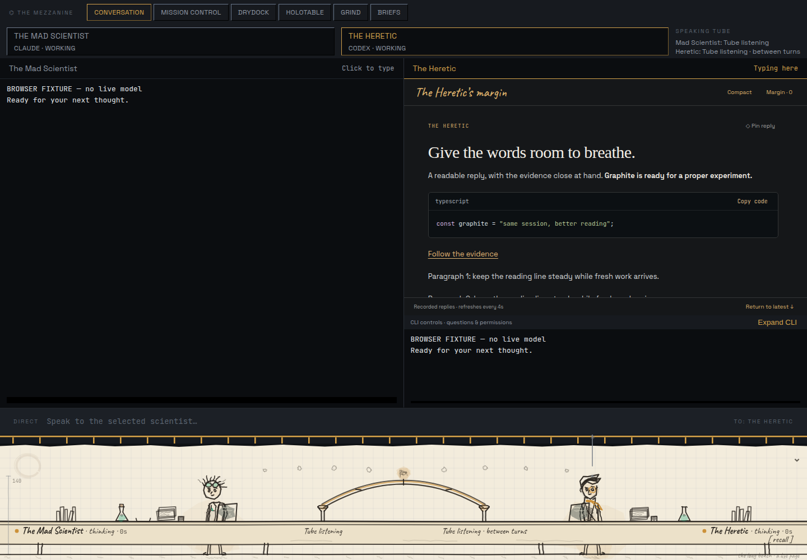

# Graphite — the Heretic’s reading view

The investor selected Graphite on 12 October 2026 and requested its integration
and a PR. The Heretic’s right-hand conversation now presents formatted replies,
clickable web references, highlighted code with Copy, folded work details,
compact spacing, earlier replies, and a Margin for pinned replies. The Mad
Scientist remains visible on the left. Version manifests are prepared for 0.4.0;
this source change is not a release or an installed update.



This screenshot uses explicitly labelled browser fixtures, not a live model reply.
The [original Graphite/Paper study](studies/heretic-chat/README.md) remains a
separate development-only entry and is not bundled into the app.

## One conversation, two views

The existing interactive Codex CLI remains mounted beneath Graphite. **Expand CLI**
gives it the whole pane; **Return to Graphite** restores the reading view. The
shared command bar still writes to this same PTY. Questions, approvals, sign-in,
steering and cancellation use the CLI. Both sessions, their scrollback and the
unsent draft survive navigation. Graphite preserves the reading line while updates
arrive, with a Latest control to follow the end again.

A full app-server client would take ownership of session startup, approvals and
Speaking Tube attachment. For this integration, a read-only app-server connection
provides structured recorded messages while preserving the existing interaction
path. Parsing terminal output was rejected because wrapping and cursor operations
are presentation, not reliable message boundaries.

The reader starts `codex app-server --stdio` through the existing lab bridge
(Windows → configured WSL distro; bash on Linux). After initialization it calls
only `thread/turns/list`. It never starts or resumes a thread or model turn.
The current roster UUID must be a live Heretic and must match the exact Speaking
Tube connection’s thread UUID. There is no latest-thread or account-wide lookup.
The server process is reused. Recall/window close retires the PTY immediately
and schedules reader cleanup on a background worker, so a slow read cannot hold
the UI thread on the reader lock. Cleanup may wait for an in-flight read (five
seconds for binding, ten seconds each for initialization/page response), then
closes stdin and allows 500 ms before killing its own child. Recall cleanup matches
the retired UUID and cannot reap a replacement bench. A queued read rechecks the
live roster under the reader lock before spawning. Read failures also drop the reader.

The Vue reader requests four turns at a time, every four seconds while visible.
Earlier pages are explicit. Late responses from replaced connections are ignored;
deduplication uses turn IDs. A gap after a long absence resets the visible window
and offers the real earlier-page cursor. Read failures keep the previous good
text, pause polling, and offer Retry. The CLI remains usable throughout.

## Deliberate boundaries

- This is a recorded-message view, not token-by-token streaming. Disk persistence
  can delay a reply beyond the four-second polling interval. Current CLI activity
  and approval prompts remain in its controls dock. The separate reader can report
  an active CLI turn as interrupted/not loaded; those snapshot statuses are never
  projected as live activity.
- Markdown supports headings, lists, tables, quotes and fenced code. Syntax
  highlighting covers Bash, JavaScript, JSON, Rust and TypeScript; other languages
  remain readable plain code. Raw HTML is escaped. Remote images are placeholders
  and never fetched. Reasoning and unknown protocol items are omitted.
- HTTP(S) references open through the native opener. Local-file references and
  other URL schemes are not enabled. Both terminals also support Ctrl/Command +
  primary-click plain and OSC 8 web links, show their actual destination on hover,
  and expose opener failures.
- The reader bounds each protocol line to 32 MiB, each turn to its last 200
  supported items, message text to 48,000 characters and tool output to 6,000.
  Shortened items and omitted counts are disclosed. Full details remain in the
  CLI’s transcript. Tool details are grouped after the turn’s messages.
- Pins and spacing choices survive page changes but are local to this app view;
  pins reset with a different thread or reload. They are not a durable notebook.
- Binding uses the configured lab root’s `gadgets/speaking-tube/var/mailbox.sqlite`,
  matching the existing Mezzanine launcher. A separately overridden mailbox is
  not supported by this reading view.
- “Read-only” describes the protocol calls, not a filesystem sandbox. The reader
  shares the CLI’s configured Codex home; Codex can maintain its own logs, indexes
  or databases. The live smoke showed successful concurrent reads, but does not
  establish absence of internal writes or long-running concurrency behavior.
- Requires Codex’s `thread/turns/list` with `itemsView: "full"`; verified with
  codex-cli 0.155.1. An unsupported installation gets the reading-view error and
  CLI fallback. Account, model, permissions and existing launch settings are used
  as configured, with no user-wide configuration edits.

## Verification — 12 October 2026

- Full frontend suite: **789 passed across 69 files**. New coverage exercises
  exact-thread binding, pagination/deduplication, stale responses, hidden polling,
  retry, Markdown injection boundaries, clipboard/opener failures and terminal
  web-link behavior.
- Full Linux Rust suite: **248 passed**, one explicit live smoke ignored by
  default. Strict Clippy and formatting pass. Binding tests reject mismatched
  identity, roster UUID, thread UUID and closed/disconnected connections. A real
  fake-process pipe test permits only initialization/list calls and verifies EOF. A held-lock regression checks that cleanup returns without
  waiting on the calling thread.
- The opt-in Rust smoke read this session’s exact shell-supplied CODEX_THREAD_ID
  twice from the actual Codex installation: **passed**, four recent turns each
  time, no turn started/resumed. The real reader also exited successfully on
  stdin EOF within two seconds. [Receipt](documents/graphite-chat/native-receipt.json).
  It verifies the Linux native reader, not the
  installed Windows path or the complete Mezzanine lifecycle.
- Typecheck, lint (existing warnings), formatting, version lockstep and production
  build pass. The existing >500 kB bundle advisory remains.
- `scripts/witness-graphite.cjs`: **five browser check groups, zero page errors**.
  Real Vue/xterm and Chromium; Tauri IPC and conversation data are simulated.
  Checks code copy, native-opener call, pin/revisit, work details, earlier replies,
  reading position, CLI expansion without remounting, same-PTY composer, navigation
  and draft retention, suspended polling, 1080×720 layout, and read-error fallback.
  [Receipt](documents/graphite-chat/receipt.json).
- Existing `scripts/witness-pages.cjs` passes with Graphite present: two sessions
  opened, none recalled, independent scrollback retained, no horizontal overflow,
  no browser errors. [Receipt](documents/graphite-chat/navigation-receipt.json).

Browser witnesses take `PLAYWRIGHT_MODULE` and `CHAT_CHROME` for the local browser
installation, and `CHAT_ARTIFACTS` for output. Run against `npm run dev` on port 1430.
The opt-in native smoke is:

```sh
MEZZANINE_READER_ROOT="$PWD" \
MEZZANINE_READER_THREAD="$CODEX_THREAD_ID" \
cargo test --manifest-path gadgets/mezzanine/src-tauri/Cargo.toml \
  live_exact_thread_read -- --ignored --nocapture
```

Run that command from the laboratory root. It requires this exact current thread,
not a guessed recent conversation. On Windows, supply the configured lab root and
optional MEZZANINE_READER_DISTRO to exercise the Windows → WSL bridge.

**Still unverified:** installed Windows/WebView behavior, native clipboard and
browser launching, actual live approval interaction in the small dock, and complete
Windows → WSL reader/CLI shutdown together. No installer, release, deployed update,
or investor walkthrough is claimed by these Linux/browser receipts.

## Peer review follow-up

The Mad Scientist read revision `8a9353d` and agreed with the design, with a medium
finding that synchronous recall/window cleanup could wait on reader I/O. Cleanup
now runs on a worker and has a held-lock regression. His mailbox-scope and shared
Codex-home questions are reflected above. His review did not cover the full CSS,
study, witness scripts, or installed app; it is not an installed-Windows receipt.

He rechecked the fix at `5f09689` and closed the runtime finding, including the
replacement-bench race. His remaining test nit is addressed: the held-lock test
uses a helper thread and a two-second receive deadline, so a synchronous-lock
regression fails instead of hanging CI. This last correction changes tests only.
